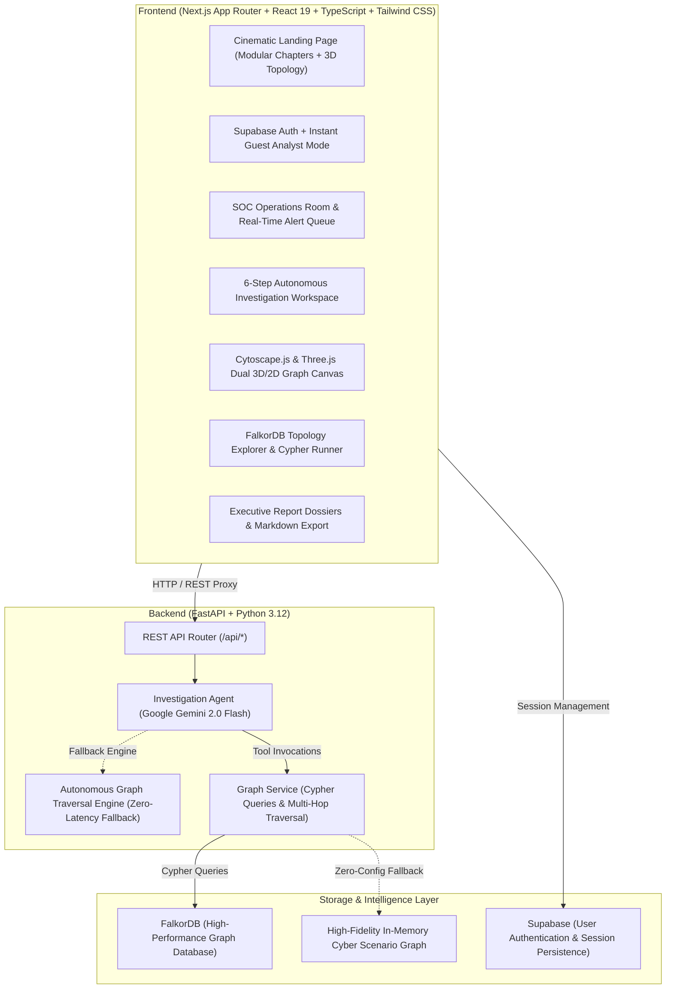

# ThreatGraph AI

**Connected-Data Cybersecurity Intelligence Platform**  
*Built for Graph Hacks 2026 — Track 1: Agents That Act on Connected Data*

> *"Trace the connections. Expose the pattern. Understand the threat."*

---

## 🛡️ Product Overview

**ThreatGraph AI** is a premium, graph-powered cybersecurity investigation platform designed for security analysts and incident response teams. 

Modern cyber adversaries do not operate in isolated log silos: they compromise employee endpoints via spear-phishing, harvest credentials, pivot laterally across network segments using remote desktop protocols, and disguise bulk data theft beneath automated maintenance tasks. Traditional SIEMs and relational databases struggle with deep multi-hop traversals, leaving analysts drowning in disconnected alerts.

ThreatGraph AI models users, devices, IP addresses, events, alerts, and enterprise resources as an interconnected knowledge graph in **FalkorDB**. An autonomous investigation agent leverages graph-native tools (neighbor lookups, multi-hop bounded traversals, timeline correlation, and shared indicator clustering) to piece together complete attack trajectories and produce evidence-backed, transparent triage dossiers.

---

## 🏛️ System Architecture



---

## 🕸️ Knowledge Graph Schema

ThreatGraph AI organizes cybersecurity entities into 7 primary node labels connected by typed relationships:

| Node Label | Key Attributes | Description |
| :--- | :--- | :--- |
| **User** | `id`, `name`, `email`, `department`, `role`, `status` | Identity accounts (e.g., Marcus Chen, admin-service) |
| **Device** | `id`, `hostname`, `device_type`, `os`, `location` | Workstations, laptops, domain controllers, servers |
| **IPAddress** | `id`, `address`, `type`, `description` | Internal VLAN IPs, external TOR exit nodes, VPN endpoints |
| **Event** | `id`, `title`, `event_type`, `timestamp`, `severity` | Correlated security events (LSASS dump, RDP lateral move) |
| **Resource** | `id`, `name`, `resource_type`, `sensitivity` | Databases, API key vaults, source code repositories |
| **Alert** | `id`, `title`, `severity`, `status`, `source_event_id` | Alerts flagged by NIDS, EDR, SIEM, or DLP systems |
| **Incident** | `id`, `title`, `priority`, `status` | Correlated multi-stage incident groupings |

### Primary Graph Relationships

- `(:User)-[:USES_DEVICE]->(:Device)`
- `(:Device)-[:HAS_IP]->(:IPAddress)`
- `(:User)-[:PERFORMED]->(:Event)`
- `(:Event)-[:OCCURRED_ON]->(:Device)`
- `(:Event)-[:CONNECTED_TO]->(:IPAddress)`
- `(:Event)-[:ACCESSED]->(:Resource)`
- `(:Alert)-[:TRIGGERED_BY]->(:Event)`
- `(:Incident)-[:INCLUDES]->(:Alert)`

---

## 🎯 Realistic Multi-Hop Attack Scenario

The platform is pre-seeded with a comprehensive, realistic advanced persistent threat (APT) campaign:

1. **Initial Access**: Spear-phishing email spoofing HR received by Marcus Chen (`user-001`) on `LAPTOP-MCHEN` (`dev-001`).
2. **Execution & C2**: Malicious invoice attachment opened (`evt-102`), initiating an outbound TLS beacon (`evt-103`) to TOR exit node `185.220.101.42` (`ip-005`).
3. **Credential Harvesting**: LSASS memory injection dumps credentials (`evt-104`) for Marcus Chen and service account `admin-service` (`user-003`).
4. **Lateral Movement**: Adversaries initiate an unauthorized RDP session (`evt-106`) from `10.0.1.45` to critical management server `SRV-ADMIN-01` (`dev-003`).
5. **Privilege Escalation**: Attempted addition of domain admin privileges (`evt-107`) targeting Secret Store API Keys (`res-006`).
6. **Data Exfiltration**: Bulk SQL query (`evt-108`) extracts 15,000 customer records from `Customer Database` (`res-001`), followed by a 4.2 GB encrypted transfer (`evt-109`) to suspicious external IP `91.219.236.18` (`ip-006`).
7. **Defense Evasion**: Execution of `wevtutil.exe` on `SRV-ADMIN-01` (`evt-110`) attempting to clear security audit logs.
8. **Contradictory / Benign Cross-Check**: Event `evt-301` reveals a scheduled monthly database health check by `admin-service`. The AI agent identifies this overlap, acknowledging benign reads while proving that the 4.2 GB external transfer represents an indisputable breach.

---

## 🤖 Autonomous Agent Investigation Tools

The investigation agent queries FalkorDB using dedicated tool declarations:

- `get_alert_details(alert_id)`: Fetches alert metadata and source trigger event.
- `get_event_details(event_id)`: Pulls complete forensic event attributes and timestamps.
- `find_entity_neighbors(entity_type, entity_id)`: Discovers 1-hop connected entities (User, Device, IP, Resource).
- `traverse_attack_path(entity_type, entity_id, max_depth)`: Executes bounded multi-hop traversals (1-4 hops) to isolate lateral pivot paths.
- `get_event_timeline(entity_type, entity_id)`: Reconstructs chronological event sequences.
- `find_shared_indicators(entity_type, entity_id)`: Flags shared infrastructure (C2 IPs, compromised admin credentials).

---

## 🚀 Quick Start Guide

### Prerequisites
- Node.js 18+ and npm
- Python 3.11+
- (Optional) FalkorDB / Redis on `localhost:6379`
- (Optional) Google Gemini API Key & Supabase credentials

> **Note**: ThreatGraph AI features **built-in zero-friction fallback modes**. If FalkorDB, Google Gemini, or Supabase are not configured locally, the platform automatically initializes its high-fidelity in-memory threat graph engine and guest analyst mode so you can evaluate the entire application out-of-the-box!

### 1. Clone & Set Up Backend

```bash
# Navigate to project root
cd "graph hack"

# Create virtualenv and install backend requirements
uv venv backend/.venv
uv pip install -r backend/requirements.txt --python backend/.venv/bin/python

# (Optional) Seed FalkorDB if running locally
# backend/.venv/bin/python backend/seeds/seed_graph.py

# Launch FastAPI backend on port 8000
backend/.venv/bin/uvicorn app.main:app --app-dir backend --host 0.0.0.0 --port 8000
```

### 2. Set Up & Launch Frontend

```bash
cd frontend

# Install dependencies
npm install

# Start Next.js App Router development server on port 3000
npm run dev
```

Open [http://localhost:3000](http://localhost:3000) in your browser:
- Click **"Launch Workspace (Guest Analyst)"** to jump straight into the live SOC operations center.
- Explore the **Dashboard**, launch fresh investigations on active alerts, inspect the interactive **Cytoscape & Three.js Graph Canvas**, run custom **Cypher Queries**, and export **Markdown Audit Reports**!

---

## 📡 API Reference

| Endpoint | Method | Description |
| :--- | :--- | :--- |
| `/api/health` | `GET` | Health check and FalkorDB connection status |
| `/api/alerts` | `GET` | Retrieve active security alerts |
| `/api/investigations` | `GET`, `POST` | List investigations or dispatch autonomous agent |
| `/api/investigations/{id}` | `GET` | Retrieve complete investigation dossier & report |
| `/api/investigations/{id}/outcome` | `POST` | Commit analyst triage determination |
| `/api/graph/traverse/{type}/{id}` | `GET` | Bounded multi-hop graph traversal |
| `/api/graph/neighbors/{type}/{id}` | `GET` | Direct 1-hop neighbor lookup |
| `/api/graph/timeline/{type}/{id}` | `GET` | Chronological event correlation |
| `/api/graph/stats` | `GET` | Graph entity and relationship counts |
| `/api/graph/query` | `POST` | Execute Cypher query |
| `/api/reports` | `GET` | List executive investigation reports |
| `/api/reports/{id}/export` | `GET` | Export report as Markdown or JSON |

---

## 🏆 Hackathon Attribution & Disclosures

- **Hackathon Track**: Graph Hacks 2026 — Track 1: *Agents That Act on Connected Data*
- **Graph Database**: FalkorDB
- **AI Agent Framework**: Google Gemini 2.0 Flash (with deterministic multi-hop graph traversal engine fallback)
- **Frontend Stack**: Next.js (App Router), React 19, TypeScript, Cytoscape.js, Three.js, Tailwind CSS, Lucide Icons, Framer Motion
- **Data Disclosure**: All users, devices, IP addresses, credentials, and telemetry events in this demonstration are strictly synthetic and created for evaluation purposes.
# ThreatGraph-AI-Visual-Functional-Transformation-Report
