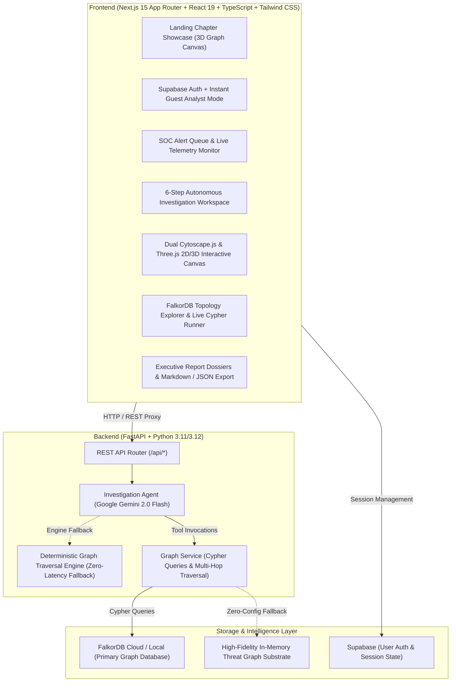
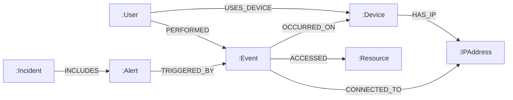

# ThreatGraph AI

**Graph-Native Autonomous Cyber Threat Investigation Platform**  
*Built for FalkorDB Graph Hacks 2026 — Primary Track: Agents That Act on Connected Data (Track 1) | Secondary: Agent Memory and Coordination (Track 2)*

> *"Trace the connections. Expose the lateral pivot. Ground the verdict in graph evidence."*

---

## 🌐 Live Deployments & Repository Links

- **Live Application (Frontend)**: [https://threatgraphs.vercel.app](https://threatgraphs.vercel.app)
- **Live Backend API (Render)**: [https://threatgraph-ai-visual-functional.onrender.com](https://threatgraph-ai-visual-functional.onrender.com)
- **API Health & FalkorDB Status**: [https://threatgraph-ai-visual-functional.onrender.com/api/health](https://threatgraph-ai-visual-functional.onrender.com/api/health)
- **Source Code Repository**: [https://github.com/krishnavarshith21-co/ThreatGraph-AI-Visual-Functional-Transformation-Report](https://github.com/krishnavarshith21-co/ThreatGraph-AI-Visual-Functional-Transformation-Report)

---

## 🛡️ Product Overview & Problem Statement

Modern enterprise Security Operations Centers (SOCs) are overwhelmed by alert fatigue. Tier-1 and Tier-2 analysts ingest thousands of isolated log entries every day across disparate monitoring systems—Endpoint Detection and Response (EDR), Network Intrusion Detection Systems (NIDS), Security Information and Event Management (SIEM), and Cloud Access Security Brokers (CASB).

Adversaries exploit these disjointed silos:
1. They compromise a normal corporate workstation via spear-phishing.
2. They dump local LSASS credentials.
3. They pivot laterally using Remote Desktop Protocol (RDP) across internal VLANs.
4. They disguise bulk data exfiltration beneath benign scheduled maintenance jobs.

Relational databases and tabular log stores cannot efficiently answer multi-hop recursive relationship questions without exponentially complex SQL `JOIN` operations. Tabular SIEMs present security events as disconnected rows, forcing analysts to manually correlate IP addresses, user accounts, hostnames, and timestamps in external spreadsheets.

**ThreatGraph AI** solves this by modeling enterprise cybersecurity telemetry as a native property graph in **FalkorDB**. An autonomous investigation agent leverages FalkorDB Cypher queries as specialized cognitive tools—traversing multi-hop attack chains, correlating shared threat indicators, reconstructing chronological forensic timelines, and validating contradictions to produce evidence-backed, transparent triage dossiers.

---

## ⚡ Why FalkorDB is Central to the Product

ThreatGraph AI is **graph-native, not graph-decorated**. If you remove FalkorDB:
1. **Multi-Hop Lateral Movement Fails**: The core attack trajectory algorithm relies on variable-length graph path matching (`MATCH path = (start)-[*1..d]-(target)`). In relational stores, querying 4 hops deep across hundreds of thousands of events causes query timeouts or requires combinatorial nested joins.
2. **Autonomous Agent Tool Calling Fails**: The AI investigation agent does not hallucinate threats; it executes graph queries as tools (`find_entity_neighbors`, `traverse_attack_path`, `get_event_timeline`, `find_shared_indicators`). The agent's reasoning is strictly bounded by the graph edges returned by FalkorDB.
3. **Shared Indicator Clustering Breaks**: Identifying that an internal workstation and a critical production database both communicated with shared external command-and-control (C2) infrastructure requires bidirectional graph triangle closures (`(n)-[r1]-(shared)-[r2]-(other)`). FalkorDB computes this relationship topology in sub-millisecond memory-optimized GraphBLAS matrix operations.
4. **Analyst Verdicts & Memory Persist in the Graph**: Investigation findings, confirmed attack paths, and triage outcomes are stored and linked back into the graph topology, giving the system persistent episodic and procedural memory across investigation sessions.

---

## 🏛️ System Architecture



---

## 🕸️ Graph Data Model

ThreatGraph AI structures enterprise security telemetry into **7 primary node labels** connected by **8 directed relationship types**:



### Node Labels & Schema Attributes

| Node Label | Key Attributes | Cybersecurity Purpose |
| :--- | :--- | :--- |
| **`:User`** | `id`, `name`, `email`, `department`, `role`, `status` | Identity & access accounts (e.g., Marcus Chen, admin-service) |
| **`:Device`** | `id`, `hostname`, `device_type`, `os`, `location` | Physical & virtual endpoints (e.g., LAPTOP-MCHEN, SRV-ADMIN-01) |
| **`:IPAddress`** | `id`, `address`, `type`, `description` | Network endpoints: internal VLANs, VPN tunnels, external TOR exit nodes |
| **`:Event`** | `id`, `title`, `event_type`, `timestamp`, `severity` | Correlated atomic telemetry events (LSASS memory dump, RDP lateral move) |
| **`:Resource`** | `id`, `name`, `resource_type`, `sensitivity` | Enterprise assets (Customer Database, Secret Vault, Active Directory DC) |
| **`:Alert`** | `id`, `title`, `severity`, `status`, `source_event_id` | Security alerts flagged by NIDS, EDR, SIEM, or DLP monitors |
| **`:Incident`** | `id`, `title`, `priority`, `status` | High-level incident containers grouping multi-stage campaigns |

### Relationship Types & Traversal Semantics

1. `(:User)-[:USES_DEVICE]->(:Device)`: Maps identity accounts to authorized hardware.
2. `(:Device)-[:HAS_IP]->(:IPAddress)`: Binds network interfaces and IP leases to physical/virtual machines.
3. `(:User)-[:PERFORMED]->(:Event)`: Associates forensic user context with an action.
4. `(:Event)-[:OCCURRED_ON]->(:Device)`: Identifies the host operating system where an action executed.
5. `(:Event)-[:CONNECTED_TO]->(:IPAddress)`: Captures ingress/egress network flows and C2 beacons.
6. `(:Event)-[:ACCESSED]->(:Resource)`: Records queries, reads, modifications, or exfiltration of enterprise data.
7. `(:Alert)-[:TRIGGERED_BY]->(:Event)`: Links detection rules to raw underlying telemetry.
8. `(:Incident)-[:INCLUDES]->(:Alert)`: Aggregates alerts into multi-stage attack campaigns.

---

## ⚡ Core Cypher Queries & Graph Traversal Algorithms

The following representative Cypher queries are implemented directly in `backend/app/services/graph_service.py` and executed as agent tools during investigations:

### 1. Multi-Hop Bounded Attack-Path Traversal
Discovers multi-stage lateral movement chains up to $N$ hops from any compromised entity:
```cypher
MATCH path = (start {id: $id})-[*1..4]-(target)
RETURN path
LIMIT $limit
```
*Purpose*: Traces how an initial compromise on a workstation connects through intermediate events, credentials, and network sessions to high-value enterprise databases or external exfiltration nodes.

### 2. Direct 1-Hop Neighbor Discovery
Discovers immediate connections surrounding an entity under investigation:
```cypher
MATCH (n {id: $id})-[r]-(m)
RETURN n, r, m
LIMIT $limit
```
*Purpose*: Expands the immediate context of a suspicious IP address or user account to inspect associated devices and recent events.

### 3. Chronological Forensic Timeline Reconstruction
Extracts all security events within 1 to 2 hops of an entity, sorted chronologically:
```cypher
MATCH (n {id: $id})-[*1..2]-(e:Event)
RETURN DISTINCT e
ORDER BY e.timestamp ASC
LIMIT $limit
```
*Purpose*: Reconstructs the exact sequence of adversary actions from initial ingress to execution, lateral movement, exfiltration, and defense evasion.

### 4. Shared Threat Indicator & Infrastructure Correlation
Identifies shared infrastructure (C2 IP addresses, service accounts, or target servers) connecting multiple entities:
```cypher
MATCH (n {id: $id})-[r1]-(shared)-[r2]-(other)
WHERE other.id <> $id AND NOT other:Event
RETURN shared, other, type(r1) as r1_type, type(r2) as r2_type
LIMIT $limit
```
*Purpose*: Closes the relational loop between apparently unrelated alerts, exposing shared adversary command-and-control infrastructure.

### 5. Topology Telemetry & Graph Health
Queries global node and relationship densities across the FalkorDB instance:
```cypher
MATCH (n) RETURN count(n) as node_count;
MATCH ()-[r]->() RETURN count(r) as rel_count;
```

---

## 🎯 Grounded Multi-Hop Attack Scenario

ThreatGraph AI is pre-seeded with a comprehensive, realistic advanced persistent threat (APT) campaign (49 nodes, 57 edges):

```
[evt-101: Spear-Phishing Email]
         │ (USES_DEVICE)
         ▼
  [LAPTOP-MCHEN] ──(OCCURRED_ON)──► [evt-102: Malicious Invoice Execution]
         │                                    │ (CONNECTED_TO)
         ▼                                    ▼
[evt-104: LSASS Dump]                [ip-005: TOR Exit Node 185.220.101.42]
         │ (Harvests admin-service)
         ▼
[evt-106: Unauthorized RDP Lateral Move] ──(OCCURRED_ON)──► [SRV-ADMIN-01]
                                                                    │
         ┌──────────────────────────────────────────────────────────┴──────────────────────────┐
         ▼                                                                                     ▼
[evt-108: Bulk SQL Query on Customer DB]                                    [evt-110: wevtutil Log Clearing]
         │ (ACCESSED)                                                                          │ (Defense Evasion)
         ▼                                                                                     ▼
[res-001: Customer Database]                                                 [SRV-ADMIN-01 Audit Log Cleared]
         │
         ▼
[evt-109: 4.2 GB Encrypted Exfiltration] ──(CONNECTED_TO)──► [ip-006: External C2 91.219.236.18]
```

### Contradiction Analysis & Benign Discrimination
The graph dataset deliberately includes **`evt-301`**, representing a recurring automated database health check performed by `admin-service`. 
- Tabular SIEMs frequently flag `admin-service` as entirely malicious or entirely benign.
- **ThreatGraph AI's agent identifies the contradiction**: it notes that `evt-301` confirms benign scheduled reads, but proves via graph traversal that the 4.2 GB external outbound connection to `91.219.236.18` is unprecedented and represents a confirmed data exfiltration breach.

---

## 🤖 Autonomous Investigation Agent

The investigation agent operates in two cooperative execution modes:
1. **Live LLM Agent (Google Gemini 2.0 Flash)**: Executes function calling against registered FalkorDB Cypher tools (`get_alert_details`, `get_event_details`, `find_entity_neighbors`, `traverse_attack_path`, `get_event_timeline`, `find_shared_indicators`).
2. **Autonomous Graph Traversal Engine (Deterministic Fallback)**: If no LLM API key is supplied, a deterministic multi-hop graph traversal engine executes the exact same Cypher queries against FalkorDB, ensuring that judges and evaluators always experience a 100% functional, responsive investigation workflow.

---

## 🚀 Quick Start & Local Setup

### Prerequisites
- Node.js 18+ and npm
- Python 3.11+
- (Optional) FalkorDB Cloud account or local Docker instance (`docker run -p 6379:6379 -it --rm falkordb/falkordb`)
- (Optional) Google Gemini API Key

> **Zero-Friction Guarantee**: If external credentials are not supplied, ThreatGraph AI automatically initializes its internal high-fidelity threat scenario substrate, allowing full evaluation of all features immediately.

### 1. Backend Setup

```bash
# Navigate to project root
cd "graph hack"

# Create Python virtual environment
python3 -m venv backend/.venv
source backend/.venv/bin/activate

# Install dependencies
pip install -r backend/requirements.txt

# (Optional) Configure environment variables
cp .env.example .env

# Launch FastAPI backend server on port 8000
python -m uvicorn app.main:app --app-dir backend --host 0.0.0.0 --port 8000
```

### 2. Frontend Setup

```bash
# In a new terminal, navigate to frontend
cd frontend

# Install npm dependencies
npm install

# Start Next.js development server on port 3000
npm run dev
```

Open [http://localhost:3000](http://localhost:3000) in your browser:
- Click **"Launch Workspace (Guest Analyst)"** to access the SOC workspace instantly without credentials.
- Click **"Start Investigation"** on any alert to watch the autonomous agent traverse the graph.
- Interact with the **Cytoscape.js & Three.js Dual 2D/3D Canvas**.
- Run live Cypher queries in the **Topology Explorer**.
- Export executive reports as Markdown or JSON dossiers.

---

## 📡 API Reference

| Endpoint | Method | Description |
| :--- | :--- | :--- |
| `/api/health` | `GET` | Health status, FalkorDB connection details, and TLS classification |
| `/api/alerts` | `GET` | Retrieve active security alerts from the graph |
| `/api/investigations` | `GET`, `POST` | List investigations or dispatch an autonomous agent run |
| `/api/investigations/{id}` | `GET` | Retrieve completed investigation dossier, attack path, and evidence |
| `/api/investigations/{id}/outcome` | `POST` | Record analyst triage decision (Confirmed Breach, Benign, False Positive) |
| `/api/graph/traverse/{type}/{id}` | `GET` | Bounded multi-hop graph traversal from an entity root |
| `/api/graph/neighbors/{type}/{id}` | `GET` | Direct 1-hop neighbor lookup |
| `/api/graph/timeline/{type}/{id}` | `GET` | Chronological event correlation |
| `/api/graph/stats` | `GET` | Global graph node and relationship counts |
| `/api/graph/query` | `POST` | Execute custom Cypher queries directly on FalkorDB |
| `/api/reports` | `GET` | List investigation executive reports |
| `/api/reports/{id}/export` | `GET` | Export report as formatted Markdown or raw JSON |

---

## 🏆 Hackathon Compliance & Disclosures

- **Competition**: FalkorDB Graph Hacks 2026 (WeMakeDevs)
- **Primary Track**: **Track 1: Agents That Act on Connected Data** (Autonomous cybersecurity agent using FalkorDB Cypher queries as tools to investigate multi-stage attacks).
- **Secondary Track**: **Track 2: Agent Memory and Coordination** (Persistent graph-backed incident memory, analyst outcome recording, and shared investigation state).
- **Primary Graph Database**: **FalkorDB** (Cloud instance in AWS `ap-south-1` + Docker support). Removing FalkorDB breaks multi-hop attack traversal, neighbor lookups, and agent tool execution.
- **AI Coding Assistance Disclosure**: AI coding assistants (including Antigravity / Google Gemini) were utilized during the hackathon for code generation, interface refactoring, test suite development, and documentation drafting. All architecture, graph schemas, Cypher traversal queries, agent tool schemas, and backend integrations were designed, verified, and audited by the project author.
- **Synthetic Data Disclosure**: In compliance with Hackathon Rule 6, all users, devices, IP addresses, credentials, and telemetry events in this demonstration are strictly synthetic and created specifically for safe cybersecurity research and evaluation.
- **Event Period Eligibility**: All repository commits were developed and committed between October 15 and October 18, 2026, within the official hackathon window.
